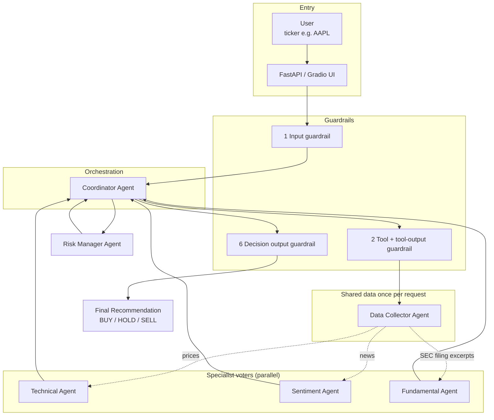
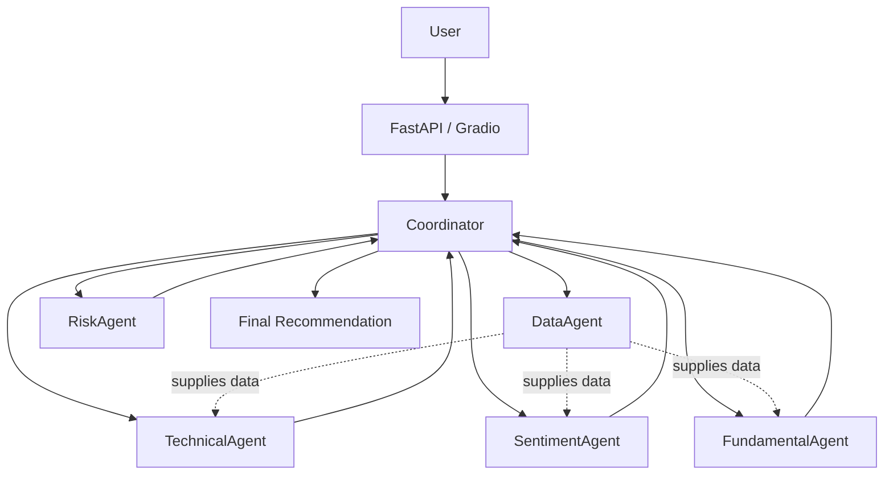

# MarketMind Architecture

MarketMind uses a simple multi-agent design that is easy to explain in class.

**Status:** Working end-to-end (DataAgent → parallel specialists → Risk →
Coordinator decision + guardrails). UI: Gradio; API: FastAPI.

For slide talking points, see also
[`PRESENTATION_AGENTS_AND_GUARDRAILS.md`](PRESENTATION_AGENTS_AND_GUARDRAILS.md).

---

## High-Level Diagram (ASCII)

```text
                User
                  |
                  v
         FastAPI / Gradio UI
                  |
                  v
           Coordinator Agent
                  |
                  v
             DataAgent (once)
      prices / company info / news / SEC filings
                  |
     +------------+------------+
     |            |            |     ← parallel
     v            v            v
 Technical   Sentiment   Fundamental
     |            |            |
     +------------+------------+
                  |
                  v
              Risk Agent
                  |
                  v
     Coordinator blends votes
                  |
                  v
         Output guardrail
                  |
                  v
         Final Recommendation
            BUY / HOLD / SELL
```

---

## Big-Picture Architecture (for class)



```text
User --> UI --> Input guardrail --> Coordinator
                                      |
                    Tool guardrail --> DataAgent (once)
                                      | prices / company info / news / filings
                 +--------------------+--------------------+
                 v                    v                    v
            Technical            Sentiment            Fundamental
                 |                    |                    |  (parallel)
                 +--------------------+--------------------+
                                      v
                                 Risk Agent
                                      v
                         Coordinator blends votes
                                      v
                         Output guardrail --> BUY/HOLD/SELL
```

---

## Classroom Mermaid (control + data supply)



**How to read it:**

- Solid arrows = control flow under the Coordinator
- Dashed arrows = DataAgent supplies shared market data
- Technical / Sentiment / Fundamental run **in parallel** after DataAgent
  (`asyncio.gather` in `CoordinatorAgent._collect_specialists`)
- Risk runs **after** those three finish
- The **Coordinator** (not Risk alone) produces BUY / HOLD / SELL; the
  decision output guardrail may adjust it (e.g. HIGH risk blocks BUY)

---

## Data Agent Role

The **Data Collector Agent** is the shared market-data source for the pipeline.

The Coordinator loads DataAgent **once** per request, then shares the result:

- historical OHLCV prices → Technical Agent + Risk Agent
- recent news headlines → Sentiment Agent (Yahoo Finance via yfinance)
- basic company / fund metadata → `DataAgentResult.company_info`
- **SEC filing excerpts** (`FilingsDataService` → OpenAI vector store, stored
  on `DataAgentResult.filings`) → Fundamental Agent (RAG over 10-K / 10-Q text)

The Fundamental Agent is **LLM-based over SEC filing evidence**, not a
yfinance fundamentals snapshot. When `FUNDAMENTALS_VECTOR_STORE_ID` is not
configured (or the store returns nothing for a ticker), the Fundamental Agent
reports `unavailable` and does not vote instead of inventing numbers.

The UIs render their charts and header from the **same** `DataAgentResult` the
agents consumed (`CoordinatorAgent.run` returns `(final, data)`), so one
Analyze click triggers exactly one market-data pull.

---

## Request Flow (current)

1. User picks a ticker (mounted UI default `AAPL`) in Gradio, or calls
   `GET`/`POST /analyze/{ticker}` on FastAPI.
2. **Input guardrail** validates ticker + horizon.
3. Coordinator asks **DataAgent** once (tool guardrails around the fetch).
4. **Technical, Sentiment, and Fundamental** run **in parallel** on that
   shared data.
5. **Risk Agent** scores LOW / MEDIUM / HIGH from prices (+ optional
   bearish flags from Sentiment / Fundamental). A Risk failure degrades to
   `unavailable` (the decision is then not risk-adjusted) instead of failing
   the run.
6. Coordinator blends votes into a draft BUY / HOLD / SELL.
7. **Decision output guardrail** validates (and may rewrite) the answer.
8. MarketMind returns a structured recommendation:

   - BUY / HOLD / SELL
   - confidence score
   - short explanation
   - supporting evidence from each agent

**Prediction horizon:** typically 5 trading days (UI also offers 3 / 10).

---

## User Interfaces

| UI | Command | Chart technology |
| --- | --- | --- |
| Mounted production UI (`app/ui.py`, served by `app/main.py` at `/`) | `python -m app.ui` or `uvicorn app.main:app` | Gradio native `gr.LinePlot` |
| Gradio-only UI (`app/ui_gradio_only.py`) | `python -m app.ui_gradio_only` | Hand-built inline SVG via `gr.HTML` (no Plotly, no Matplotlib) |

Both consume the same agents and the same `DataAgentResult`.

---

## Why This Architecture?

- Each agent has one clear job (specialization).
- The Coordinator combines results (orchestration).
- Specialists fan out in parallel on shared data (efficiency + clear votes).
- Outputs are structured with Pydantic models (explainability).
- Guardrails wrap input, tools, and outputs (classroom safety pattern).
- The design stays small enough for a course presentation.

---

## Related docs

| Doc | Purpose |
| --- | --- |
| [`AGENTS.md`](AGENTS.md) | Per-agent roles and I/O |
| [`DATA_AGENT.md`](DATA_AGENT.md) | DataCollector deep dive |
| [`TECHNICAL_AGENT.md`](TECHNICAL_AGENT.md) | Technical indicators |
| [`PRESENTATION_AGENTS_AND_GUARDRAILS.md`](PRESENTATION_AGENTS_AND_GUARDRAILS.md) | Presentation script |
| [`ROADMAP.md`](ROADMAP.md) | Phase checklist |
